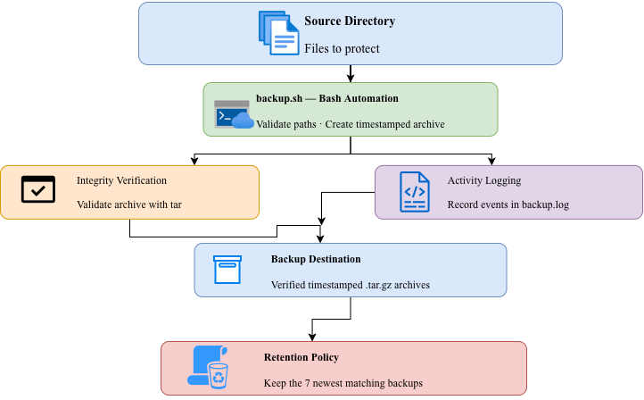
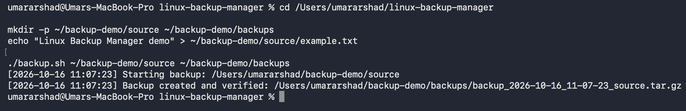
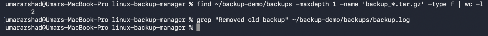
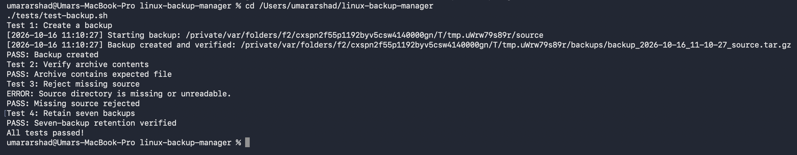

# Linux Backup Manager

A Bash-based backup automation tool that creates timestamped compressed archives, verifies archive integrity, logs operations, and automatically retains the seven newest backups.

## Features

- Timestamped `.tar.gz` backups
- Source directory validation
- Archive integrity verification
- Timestamped activity and error logs
- Automatic retention of the seven newest matching backups
- Automated tests
- Compatible with macOS Bash 3.2 and common Linux Bash environments

## Requirements

- Bash
- `tar`
- Standard Unix utilities

## Architecture

The diagram below illustrates the Linux Backup Manager workflow, including source validation, archive creation, integrity verification, logging, and backup retention.



The editable diagram source is available here: [linux-backup-manager.drawio](docs/diagrams/linux-backup-manager.drawio).

## Screenshots

### 1. Successful Backup

Demonstrates the creation and verification of a timestamped compressed backup archive.



### 2. Backup Retention

Shows the retention policy that keeps the seven newest matching backup archives.



### 3. Automated Tests

Displays the automated test results for backup creation, archive contents, invalid source handling, and backup retention.



## Usage

Make the script executable:

```bash
chmod +x backup.sh
```

Run a backup:

```bash
./backup.sh /path/to/source /path/to/backups
```

Example:

```bash
mkdir -p ~/backup-demo/source
echo "Hello backup" > ~/backup-demo/source/example.txt

./backup.sh ~/backup-demo/source ~/backup-demo/backups
```

## Logs

The script creates `backup.log` in the backup destination. It records timestamps, backup results, and retention cleanup activity.

## Retention Policy

The script keeps the seven newest matching backup archives in the selected destination and removes older matching archives after a successful archive verification.

**Important:** Test the script with disposable files before using it for important data. This project is a learning tool, not a replacement for a tested disaster-recovery system or off-site backup strategy.

## Automated Tests

Run the test suite:

```bash
chmod +x tests/test-backup.sh
./tests/test-backup.sh
```

The tests check backup creation, archive contents, missing-source handling, and seven-backup retention.

## Project Structure

```text
linux-backup-manager/
├── backup.sh
├── tests/
│   └── test-backup.sh
└── README.md
```

## Skills Demonstrated

- Bash scripting
- Linux and macOS command-line tools
- File archiving with tar
- Input validation and error handling
- Logging and retention automation
- Automated testing
- Git and GitHub

## Future Improvements

- Dry-run mode
- Configurable retention count
- Exclusion patterns
- Restore command
- GitHub Actions CI testing

